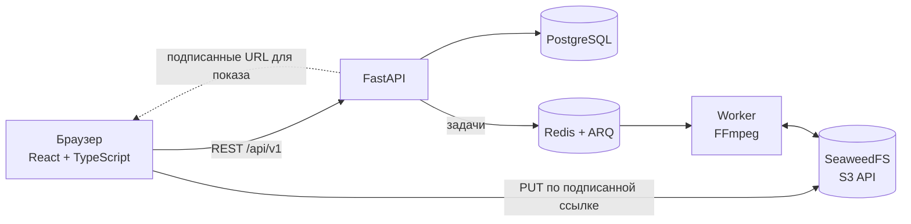

<div align="center">

<picture>
  <source media="(prefers-color-scheme: dark)" srcset="assets/avito-logo-dark.svg">
  
</picture>

<br><br>

# SwipeMarket — «Свайп» для Авито

**Покупки как в рилсах: листаешь ленту коротких видео, свайпом сохраняешь товар в вишлист и делишься им с друзьями.**

<br>


<br>

[О проекте](#о-проекте) · [Возможности](#возможности) · [Архитектура](#архитектура) · [Технологии](#технологии) · [Быстрый запуск](#быстрый-запуск) · [API](#api-и-сервисы) · [Тесты](#миграции-и-тесты)

</div>

<br>

| Лента рилсов | Вишлист и доступ по ссылке | Рилс продавца |
|:---:|:---:|:---:|
|  |  |  |

## О проекте

**SwipeMarket** — полнофункциональный демонстрационный проект: покупатели находят товары в вертикальной ленте коротких видео и фотографий, а продавцы создают рилсы для своих объявлений. Понравившиеся товары попадают в вишлист, которым можно поделиться по ссылке.

В репозитории — backend на **FastAPI**, frontend на **React + TypeScript**, фоновая обработка медиа на **ARQ + FFmpeg**, локальная инфраструктура на **Docker Compose** и иллюстрации интерфейса.

> [!NOTE]
> Проект предназначен для разработки и демонстрации. Интеграции оплаты и часть пользовательских данных демонстрационные; перед эксплуатацией в production необходимы отдельная настройка безопасности, хранилища и инфраструктуры.

## Возможности

<table>
<tr>
<td valign="top" width="33%">

### Покупателям

- Лента рилсов: видео, фото и фотоальбомы
- Персонализация по выбранным категориям
- Свайпы и кнопки: «Хочу», «Не то», «Пропустить», «Назад»
- Вишлист и публичная ссылка на него

</td>
<td valign="top" width="33%">

### Продавцам

- Загрузка видео или до 10 фото
- Прямая загрузка в S3 по временной ссылке
- Фоновая обработка: проверка длительности, конвертация, постер, вертикальный формат
- Кадрирование, порядок фото, предпросмотр
- Статусы модерации, статистика, демо-продвижение

</td>
<td valign="top" width="33%">

### Разработке

- Гостевая и демо-авторизация: покупатель, друг, продавец
- REST API с интерактивной документацией OpenAPI
- Служебные endpoints для модерации и обновления объявлений
- Демоданные (`seed.py`) и тесты backend

</td>
</tr>
</table>

## Архитектура



### Загрузка медиа

1. Frontend запрашивает у API временный URL для загрузки.
2. Браузер загружает файл **напрямую** в SeaweedFS, не пересылая его через API.
3. API ставит задачу обработки в Redis/ARQ.
4. Worker проверяет и обрабатывает изображение или видео с помощью FFmpeg, сохраняет результат и постер в SeaweedFS.
5. API возвращает frontend подписанные ссылки для отображения. В локальной конфигурации они действуют один час.

### Инженерные решения

| Решение | Зачем |
|---|---|
| Прямая загрузка в S3 по подписанным ссылкам | API не нагружается тяжёлым трафиком и не хранит файлы |
| Фоновая обработка видео в отдельном worker | Ответы API остаются быстрыми, обработка масштабируется независимо |
| Асинхронный стек: FastAPI + SQLAlchemy async + asyncpg | Высокая пропускная способность на I/O-нагрузке |
| Миграции Alembic | Воспроизводимая схема БД |
| Роли и разделение доступа (пользователь, внутренний и административный ключи) | Безопасное разграничение публичных, внутренних и админских операций |
| Модерация и статусы рилсов | Контролируемая публикация контента продавцов |
| Изолированные тесты на SQLite | Запуск без отдельной тестовой БД |

## Технологии

| Слой | Стек |
|---|---|
| **Backend** |     |
| **Данные** |    |
| **Фон и очереди** |   |
| **Медиа** |   |
| **Frontend** |     |
| **Инфраструктура** |   |

## Скриншоты

<details>
<summary>Открыть галерею</summary>

### Главная страница и переход в «Свайп»


### Лента видео и управление свайпами


### Настройка рекомендаций


### Создание и отображение рилсов


### Вишлисты


</details>

## Требования

- Git
- Docker Desktop с Docker Compose
- Node.js 18+ и npm — для запуска frontend вне Docker

Backend, PostgreSQL, Redis и SeaweedFS запускаются через Docker. Python на хост-компьютере нужен только для запуска backend-тестов вне контейнера.

## Быстрый запуск

### 1. Получить проект

```bash
git clone https://github.com/IldarMuzaferov/SwipeMarket.git
cd SwipeMarket
```

### 2. Запустить backend

<details open>
<summary>PowerShell</summary>

```powershell
Copy-Item .env.example .env
docker compose up --build -d
docker compose exec api alembic upgrade head
```

</details>

<details>
<summary>macOS / Linux</summary>

```bash
cp .env.example .env
docker compose up --build -d
docker compose exec api alembic upgrade head
```

</details>

API будет доступен на `http://localhost:8000`.

### 3. Запустить frontend

Откройте **второй** терминал в корне репозитория.

<details open>
<summary>PowerShell</summary>

```powershell
Set-Location avito-swipe-web
Copy-Item .env.example .env
npm install
npm run dev
```

</details>

<details>
<summary>macOS / Linux</summary>

```bash
cd avito-swipe-web
cp .env.example .env
npm install
npm run dev
```

</details>

Откройте **http://localhost:3000**.

> [!IMPORTANT]
> Используйте именно `localhost`, а не `127.0.0.1`: backend по умолчанию разрешает CORS для `http://localhost:3000`. Порт frontend закреплён в `vite.config.ts`; если он занят, остановите другой процесс на порту 3000.

### 4. Добавить демонстрационные данные (необязательно)

```bash
docker compose exec api python seed.py
```

Seed добавляет примеры пользователей, категорий, объявлений, рилсов, вишлиста и тарифов. Повторный запуск не дублирует данные. Примеры URL некоторых медиа в seed — заглушки `cdn.example.com`; для проверки реальной загрузки используйте форму продавца и загрузите свои фото или видео.

## Приложение и демонстрационные роли

| URL | Назначение |
|---|---|
| `/` | Главная страница |
| `/onboarding` | Выбор интересов для рекомендаций |
| `/swipe` | Лента рилсов |
| `/my/wishlist` | Личный вишлист и настройки доступа |
| `/wishlist/:token` | Публичный вишлист по ссылке |
| `/seller/reel` | Создание рилса |
| `/seller/listings` | Рилсы и объявления продавца |

При первом открытии frontend автоматически создаёт гостевого пользователя. Чтобы переключиться на демо-роль, нажмите на аватар в правом верхнем углу и выберите **«Демо: войти как»**. Для публикации рилса используйте роль продавца.

## API и сервисы

| Сервис | Адрес |
|---|---|
| Frontend | http://localhost:3000 |
| API | http://localhost:8000 |
| Swagger UI | http://localhost:8000/docs |
| OpenAPI JSON | http://localhost:8000/openapi.json |
| Проверка API | http://localhost:8000/api/v1/health |
| Готовность зависимостей | http://localhost:8000/api/v1/ready |
| SeaweedFS S3 API | http://localhost:9000 |
| SeaweedFS filer UI | http://localhost:8888 |
| SeaweedFS master UI | http://localhost:9333 |

Маршруты используют префикс `/api/v1`. Защищённые endpoints принимают bearer token в заголовке `Authorization`. Полные схемы запросов и ответов — в Swagger UI.

**Основные группы API**

| Группа | Назначение |
|---|---|
| `/auth`, `/users`, `/categories` | Авторизация, профиль и рекомендации |
| `/feed`, `/swipes`, `/reels`, `/listings` | Лента, действия покупателя и карточки товара |
| `/media/uploads`, `/me/listings`, `/me/reels` | Загрузка медиа и инструменты продавца |
| `/wishlist`, `/public/wishlists` | Личные и публичные вишлисты |
| `/promotion`, `/promotions`, `/payments` | Тарифы и демонстрационное продвижение |
| `/internal`, `/admin` | Внутренние операции и модерация |

## Конфигурация

Корневой `.env.example` — шаблон настроек Docker Compose и backend. Скопируйте его в `.env` перед запуском. Файл `.env` игнорируется Git и не должен попадать в коммиты.

<details>
<summary>Переменные окружения backend</summary>

| Переменная | Назначение |
|---|---|
| `DATABASE_URL` | URL подключения к PostgreSQL |
| `REDIS_URL` | URL Redis для фоновой очереди |
| `S3_ENDPOINT` | Внутренний endpoint S3 для API и worker |
| `S3_PUBLIC_ENDPOINT` | Публичный endpoint S3 для браузера и подписанных ссылок |
| `S3_ACCESS_KEY`, `S3_SECRET_KEY` | Учётные данные локального S3-хранилища |
| `S3_BUCKET` | Имя bucket |
| `SECRET_KEY`, `ALGORITHM` | Подпись токенов авторизации |
| `AUTO_PUBLISH` | Автоматически публиковать рилсы или отправлять на модерацию |
| `FRONTEND_ORIGIN` | Разрешённый CORS origin frontend |
| `PUBLIC_BASE_URL` | Публичный URL backend |
| `INTERNAL_API_KEY`, `ADMIN_API_KEY` | Ключи внутренних и административных endpoints |
| `PAYMENT_WEBHOOK_SECRET` | Секрет проверки webhook оплаты |
| `MOCK_PAYMENT_BASE_URL` | Базовый URL демонстрационной оплаты |
| `SQL_ECHO` | SQL-логи при разработке |

</details>

В `S3_ENDPOINT` указывают внутренний адрес хранилища, доступный API и worker из Docker-сети. `S3_PUBLIC_ENDPOINT` — адрес, доступный браузеру. В локальном Compose это `http://seaweedfs:9000` и `http://localhost:9000`. Если меняете порты или домены, обновите оба значения согласованно.

Frontend использует собственный файл `avito-swipe-web/.env`:

```env
VITE_API_URL=http://localhost:8000/api/v1
```

Для другого адреса API измените `VITE_API_URL` и перезапустите Vite.

## Разработка frontend

Команды выполняются из папки `avito-swipe-web`:

```bash
npm install
npm run dev
npm run typecheck
npm run build
```

`npm run build` создаёт production-сборку в `dist/`, `npm run preview` запускает локальный просмотр собранного frontend.

## Миграции и тесты

```bash
# применить миграции
docker compose exec api alembic upgrade head

# тесты backend в контейнере
docker compose exec api python -m pytest -q
```

Тесты используют изолированную SQLite-БД и не требуют отдельного PostgreSQL. Если Python и зависимости настроены локально, запустить тесты из корня можно так:

```powershell
.\.venv\Scripts\python.exe -m pytest -q
```

## Структура репозитория

```text
.
├── app/
│   ├── api/v1/            # HTTP endpoints
│   ├── core/              # конфигурация и безопасность
│   ├── db/                # SQLAlchemy-модели и подключение к БД
│   ├── schemas/           # Pydantic-схемы API
│   ├── services/          # хранилище и рекомендации
│   └── worker/            # фоновые задачи обработки медиа
├── alembic/               # миграции PostgreSQL
├── tests/                 # тесты backend
├── avito-swipe-web/
│   └── src/
│       ├── api/           # API-клиент и TypeScript-типы
│       ├── components/    # переиспользуемые React-компоненты
│       ├── lib/           # загрузка файлов и утилиты
│       ├── pages/         # страницы приложения
│       └── styles/        # CSS
├── assets/                # логотип для README
├── DemoPic/               # изображения интерфейса для README
├── docker-compose.yml
├── Dockerfile
├── requirements.txt
└── seed.py
```

## Полезные команды Docker

```bash
docker compose ps
docker compose logs -f api worker
docker compose logs -f postgres redis seaweedfs
docker compose restart api worker
docker compose down
```

`docker compose down` останавливает сервисы, сохраняя данные в именованных томах. Команда `docker compose down -v` также удаляет тома с локальной базой данных и медиа — используйте её только если действительно хотите сбросить локальные данные.

## Устранение неполадок

<details>
<summary>Не открывается <code>localhost:8000</code></summary>

Проверьте, что Docker Desktop запущен, затем выполните `docker compose ps` и `docker compose logs -f api`.

</details>

<details>
<summary>API не готов после первого запуска</summary>

Примените миграции: `docker compose exec api alembic upgrade head`.

</details>

<details>
<summary>Frontend не может обратиться к API</summary>

Откройте `http://localhost:3000`, проверьте `VITE_API_URL` и значение `FRONTEND_ORIGIN` в корневом `.env`.

</details>

<details>
<summary>Браузер не загружает файл в S3</summary>

Проверьте доступность `S3_PUBLIC_ENDPOINT`, CORS SeaweedFS для origin frontend и bucket. Для локального Compose разрешены `localhost:3000` и `localhost:5173`.

</details>

<details>
<summary>Фото или видео не отображается</summary>

Проверьте `docker compose logs -f worker`, статус загрузки через API и доступность SeaweedFS. Ссылки на медиа подписываются и истекают через час — обновите страницу или заново запросите данные из API.

</details>

<details>
<summary>Порт уже занят</summary>

Освободите порт `8000`, `5432`, `6379`, `9000` или `3000`, либо измените mapping портов в Compose и соответствующие адреса в `.env`.

</details>

## Безопасность

Значения в `.env.example` предназначены только для локальной разработки. Перед любым внешним развёртыванием задайте уникальные секреты и пароли, ограничьте доступ к PostgreSQL, Redis и SeaweedFS, настройте HTTPS и проверьте доступность внутренних и административных endpoints. Не публикуйте `.env`, реальные ключи, пароли или пользовательские файлы.

---

<div align="center">

Автор — [Ильдар Музафаров](https://github.com/IldarMuzaferov), Backend Python Developer

</div>
